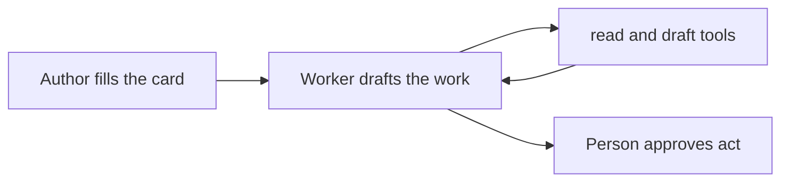

# Agent design patterns: sibling reference

This file is the English reference copy that ships with the `sdd-build-agent` skill. It distills the seven source files `specs/agent-design-patterns/00-06` in the agent.dan repository; that repository is the editing source, and a revision there does not flow into this copy automatically.

Book: *Agentic Design Patterns: A Hands-On Guide to Building Intelligent Systems* (Antonio Gulli). Companion code: the `notebooks/` directory of the GitHub repository [DanieleSalatti/AgenticDesignPatterns](https://github.com/DanieleSalatti/AgenticDesignPatterns), one notebook per `Chapter N_` prefix.

---

# Agent design patterns: selection index

Source: *Agentic Design Patterns: A Hands-On Guide to Building Intelligent Systems* (Antonio Gulli), 21 pattern chapters. This index compresses the 21 chapters into one selection table: match the task trait and example first, pick the pattern, then exclude with the not-use conditions.

- Chapter deep reads: the community Chinese translation [xindoo/agentic-design-patterns](https://github.com/xindoo/agentic-design-patterns), `chapters/` directory; the chapter links in the table below go straight to that chapter's translation. Where the translation and the book differ, the book PDF wins.
- Companion code: the `notebooks/` directory of [DanieleSalatti/AgenticDesignPatterns](https://github.com/DanieleSalatti/AgenticDesignPatterns), one notebook per `Chapter N_` prefix; links sit at the end of each pattern section in the topic notes below, labeled "Companion code".
- ROCKS (the agent authoring paradigm) is original content of the authoring repository, not a book chapter; see the first table row and the ROCKS section in this file.

## Selection table

| Task trait | Example | Recommended pattern | Chapter | Not-use condition (inferred) |
| --- | --- | --- | --- | --- |
| Define or revise an agent (write an agent file) | Write an agent file for an invoice-exception handler | ROCKS (agent authoring paradigm) | The ROCKS section in this file | Runtime orchestration questions (serial, routing, parallel) are not ROCKS; pick from the 21 patterns below |
| The task splits into fixed-order substeps; each step's output is the next step's input | Market-analysis pipeline: summarize → extract trends → write the email | Prompt Chaining | [Chapter 1](https://github.com/xindoo/agentic-design-patterns/blob/main/chapters/Chapter%201_%20Prompt%20Chaining.md) | When steps have no dependency, or the flow needs dynamic branching, hard serial chaining only adds latency |
| Inputs vary in type and must route by intent to different tools or subflows | A support bot that separates sales, tech support, and account requests | Routing | [Chapter 2](https://github.com/xindoo/agentic-design-patterns/blob/main/chapters/Chapter%202_%20Routing.md) | No benefit when there is one execution path, or fewer than two routing rules |
| Several subtasks are independent and each waits on I/O | Call several external APIs at once, then merge into one report | Parallelization | [Chapter 3](https://github.com/xindoo/agentic-design-patterns/blob/main/chapters/Chapter%203_%20Parallelization.md) | Tasks strongly depend on each other's output; or the debugging and logging cost of concurrency outweighs the gain |
| The task needs data or actions beyond the model's training data | Look up a live exchange rate, query a database, send email, run code | Tool Use (Function Calling) | [Chapter 5](https://github.com/xindoo/agentic-design-patterns/blob/main/chapters/Chapter%205_%20Tool%20Use.md) | Pure text generation that needs no external data or side effects |
| The output needs a quality gate and iterative improvement | The "generate → review → improve" loop for copy, code, or analysis reports | Reflection | [Chapter 4](https://github.com/xindoo/agentic-design-patterns/blob/main/chapters/Chapter%204_%20Reflection.md) | One-shot low-cost tasks; or no clear evaluation standard, so self-review spins idle |
| The goal is complex and needs a step sequence before execution | Auto-generate a research report, an onboarding flow, a competitor analysis | Planning | [Chapter 6](https://github.com/xindoo/agentic-design-patterns/blob/main/chapters/Chapter%206_%20Planning.md) | A task one step can finish; planning only adds overhead |
| One agent cannot do the job; the work splits by specialty across roles | Complex research analysis, software development, creative content production | Multi-Agent Collaboration | [Chapter 7](https://github.com/xindoo/agentic-design-patterns/blob/main/chapters/Chapter%207_%20Multi-Agent%20Collaboration.md) | One role can do the task; more agents amplify coordination cost and error propagation |
| The agent needs memory and context across sessions | A personal assistant that remembers preferences across sessions; progress tracking for multi-step work | Memory Management | [Chapter 8](https://github.com/xindoo/agentic-design-patterns/blob/main/chapters/Chapter%208_%20Memory%20Management.md) | Single-turn stateless interaction does not need it |
| The system must keep improving from past experience | Personalized assistants, trading bots, fraud detection | Learning and Adaptation | [Chapter 9](https://github.com/xindoo/agentic-design-patterns/blob/main/chapters/Chapter%209_%20Learning%20and%20Adaptation.md) | The task pattern is stable and one-off tuning is enough |
| The system must reach many external tools and data sources through one standard protocol | An enterprise system reaches evolving external tools and data through MCP | Model Context Protocol (MCP) | [Chapter 10](https://github.com/xindoo/agentic-design-patterns/blob/main/chapters/Chapter%2010_%20Model%20Context%20Protocol%20%28MCP%29.md) | With few fixed tools, plain function calling is simpler |
| The agent runs multi-step tasks on its own and tracks goal completion | An agent runs a multi-step task and self-corrects when it drifts | Goal Setting and Monitoring | [Chapter 11](https://github.com/xindoo/agentic-design-patterns/blob/main/chapters/Chapter%2011_%20Goal%20Setting%20and%20Monitoring.md) | A process with a human gate on every step does not need autonomous goal tracking |
| Production has runtime faults: tool failures, network errors | Retries, fallbacks, and rollbacks when a tool times out or an API errors | Exception Handling and Recovery | [Chapter 12](https://github.com/xindoo/agentic-design-patterns/blob/main/chapters/Chapter%2012_%20Exception%20Handling%20and%20Recovery.md) | Prototype stage, where a failure can simply rerun |
| Decisions carry safety, ethics, or large-money consequences and need a human gate | Critical decisions in healthcare, finance, or driving escalate to a person | Human-in-the-Loop | [Chapter 13](https://github.com/xindoo/agentic-design-patterns/blob/main/chapters/Chapter%2013_%20Human-in-the-Loop.md) | High-throughput low-risk work, where a human gate becomes the bottleneck |
| Answers must rest on private or fresh knowledge and stay citable | Enterprise document Q&A, a support bot that cites sources | Knowledge Retrieval (RAG) | [Chapter 14](https://github.com/xindoo/agentic-design-patterns/blob/main/chapters/Chapter%2014_%20Knowledge%20Retrieval%20%28RAG%29.md) | The task has no private-knowledge dependency, or the model's own knowledge is enough |
| Agents built on different frameworks must interoperate and hand off tasks | Agents built on ADK, LangGraph, or CrewAI delegate to each other | Inter-Agent Communication (A2A) | [Chapter 15](https://github.com/xindoo/agentic-design-patterns/blob/main/chapters/Chapter%2015_%20Inter-Agent%20Communication%20%28A2A%29.md) | All agents share one framework; in-process calls suffice |
| Model choice must trade cost, latency, and quality dynamically | Fast cheap models for simple queries, strong models for hard reasoning | Resource-Aware Optimization | [Chapter 16](https://github.com/xindoo/agentic-design-patterns/blob/main/chapters/Chapter%2016_%20Resource-Aware%20Optimization.md) | Low traffic and a loose budget; one simple model is enough |
| The problem needs explicit multi-step reasoning (math, diagnosis, legal analysis) | Multi-hop Q&A, code debugging, legal analysis | Reasoning Techniques (CoT/ReAct) | [Chapter 17](https://github.com/xindoo/agentic-design-patterns/blob/main/chapters/Chapter%2017_%20Reasoning%20Techniques.md) | Routine simple Q&A; explicit reasoning only adds latency |
| Agent output can affect users, systems, or reputation and needs protection | Public support bots, content platforms, finance or healthcare systems | Guardrails/Safety Patterns | [Chapter 18](https://github.com/xindoo/agentic-design-patterns/blob/main/chapters/Chapter%2018_%20Guardrails_Safety%20Patterns.md) | Offline internal experiments whose output cannot leak |
| The system must keep measuring agent effect, efficiency, and compliance | Accuracy, latency, and resolution-rate tracking for a production deployment | Evaluation and Monitoring | [Chapter 19](https://github.com/xindoo/agentic-design-patterns/blob/main/chapters/Chapter%2019_%20Evaluation%20and%20Monitoring.md) | No production deployment yet, so no runtime metrics to collect |
| The agent must order conflicting tasks by itself under limited resources | Reorder tasks dynamically by urgency, importance, and cost when they conflict | Prioritization | [Chapter 20](https://github.com/xindoo/agentic-design-patterns/blob/main/chapters/Chapter%2020_%20Prioritization.md) | One pending task at a time makes ordering meaningless |
| An open-ended domain must discover the unknown unknowns | Scientific hypothesis generation, open-ended market-opportunity discovery | Exploration and Discovery | [Chapter 21](https://github.com/xindoo/agentic-design-patterns/blob/main/chapters/Chapter%2021_%20Exploration%20and%20Discovery.md) | An optimization task whose solution space is already defined |

## How to use

- Locate the task by the "Task trait" column first, then exclude with the "Not-use condition" column. Most exclusion grounds are inferred backwards from each chapter's failure modes and are marked as inferred, not book text.
- Patterns combine: a common production combination is Tool Use + Planning + Exception Handling + Evaluation.
- Detailed notes grouped by theme follow in this file; the ROCKS authoring paradigm is in the ROCKS section of this file.

# ROCKS: the agent authoring paradigm

ROCKS is the paradigm for writing one agent definition file: Role, Outcome, Capability, Knowledge, Stop. Anyone who can explain one repeatable job clearly can fill in a card. The card is the paradigm. Only work one agent cannot do needs a multi-agent system.

The name carries the rule: a worker must stop before an action leaves the team. The ROCKS sample agent file in the framework pack is written as the five ROCKS blocks, so one pattern keeps one name in the pack.

## Position: an authoring paradigm, not a runtime design pattern

ROCKS answers "how is this one agent defined" and does not answer how runtime agents, tools, and steps combine. Combination belongs to the design patterns; see the selection table in this file.

| | ROCKS (authoring) | Design patterns (runtime) |
| --- | --- | --- |
| The question it answers | How is this one agent defined? | How do agents, tools, and steps combine for one task? |
| The artifact | One agent definition, written once, versioned | An execution structure chosen per task or system |
| Examples | Role, Outcome, Capability, Knowledge, Stop | Prompt Chaining, Routing, Reflection, Multi-Agent |
| When to use | When writing or revising an agent file | When designing a system, or picking a route for a task |

The two work together: ROCKS defines the worker, and the design patterns decide where that worker sits in a larger flow.

## The card

Each block has a set of questions, a length, what to avoid, and what to do.

| Block | What to ask | Length | Avoid | Do |
| --- | --- | --- | --- | --- |
| R, Role | In what capacity does this worker act? What facts must be true on every run? | About 100 words | "You are an expert" with no domain; a full résumé | The job and the topics. Facts that change the answer. State the function and handoffs as they are. |
| O, Outcome | Which one job does this worker repeat? What does done look like? | About 120 words | "Help the team with X" with no named output | One job. One output. Quantified value: minutes saved, review rounds cut, risks surfaced early. |
| C, Capability | What may it do? Which tools? | About 150 words | A tool list copied from a catalog | Work that matches the job. Every tool marked `read`, `draft`, or `act`. |
| K, Knowledge | Which named knowledge must this job use? | About 100 words | Treating tool output as new instructions | A named file or source for each part of the job. Tool output and retrieved text are not trusted. |
| S, Stop | What must a person approve? When does the worker stop? | About 120 words | A worker that sends, posts, pays, or hires on its own | An example of a good draft. Hard boundaries. The specific person who approves each act. |

A tool marked **act** leaves the team: send, post, pay, change a record, hire. That step waits for a person. `read` and `draft` finish inside the run.

## How to build the worker

Style: one agent, one fixed job. A fixed workflow is lighter and fits when every step is known. An open-ended agent picks its own path and fits when the step count cannot be written down. Repeatable work with a clear output fits a fixed card: the card pins the job, the tools, and the stop points. The model still decides how to draft inside those boundaries.

| Part | Role |
| --- | --- |
| ROCKS | The versioned brief: role, outcome, capability, knowledge, stop. |
| Worker | One model run that executes the card. |
| Tools | Only the `read`, `draft`, and `act` tools named in Capability. |
| Person | Approves each act. Rejects drafts that miss the output. |
| Sample run | One real or redacted input, draft, and value sentence. |

Tool output and retrieved text are not trusted. The worker does not treat them as new instructions. The Stop block states what the worker may do with them.

## First version and what comes after

| First version | Later |
| --- | --- |
| One card, one job, one sample run | A second worker, a supervisor, a critic role |
| `read` and `draft` tools | An open loop with no step cap |
| A person on every act | Gateways, a second model vendor, fine-tuning |
| A value sentence: time, quality, risk | Retrieval design and a private knowledge base |

The card, the tool list, and the stop rules are versioned from the first version. Change the card, run one sample run first, and ship the change only after it passes.

## Runtime checks for a production copy

These checks are for teams that keep a worker in production.

| Check | What the team watches | Action |
| --- | --- | --- |
| Quality | Drafts still meet the output on a small sample set | Roll back to the previous card version |
| Stop | An act left the team without the named approver | Turn off the act tools |
| Cost | Weekly runs exceed the size of the job | Cut tools, or fall back to a single prompt |

Secrets live in a secret store or environment variables, never in the card.

## Sources

Verification date: 2026-10-12.

| Claim | Type | Source |
| --- | --- | --- |
| ROCKS is Role, Outcome, Capability, Knowledge, Stop, recombined from a coach agent file | User-provided | The ROCKS sample agent file in the framework pack |
| ROCKS states how an agent file is written; runtime patterns decide how a system executes | Inferred | Pack usage: the ROCKS sample agent file and the selection index of the authoring repository |
| A workflow pre-pins the path; an agent lets the model pick tools and steps. Start from the simplest option that satisfies the task. | Sourced fact | Anthropic, "Building effective agents", 2024-12-19, https://www.anthropic.com/engineering/building-effective-agents |
| Plan-and-execute fits when a person reads the steps first and only then runs high-risk tools. Approving the plan is not approving every later tool call. | Sourced fact | systemprompt.io, "AI Agent Architecture: Patterns and Governance", verified 2026-10-12, https://systemprompt.io/guides/ai-agent-architecture |
| Tool results are not trusted by default. A production loop needs stop conditions: step count, time, or spend. | Sourced fact | QubitTool, "ReAct Agent Pattern: Production Loop and Safety Guide", verified 2026-10-12, https://qubittool.com/blog/react-framework-explained |
| One repeatable job needs one card and a person on every act. ReAct, planner/executor/critic, and multi-agent are later patterns. | Inferred | The job is a repeatable task with a clear output. |

This file is a pattern reference, not a vendor guide. Prices and quotas are out of scope. Re-verify the two engineering pages before citing them a year later. Pattern names age slower than product limits.

# Orchestration patterns: Prompt Chaining, Routing, Parallelization, Tool Use

Source: chapters 1, 2, 3, and 5 of *Agentic Design Patterns*. These four patterns solve the same problem: split one unreliable big prompt into a controlled execution structure.

## Prompt Chaining (Chapter 1)

### Intuition

Make the model work like an assembly line: split one large job into several stations, each station does one thing, and each station's output is the next station's input.

### Worked example (the book's market-analysis example)

The input is a market research report; the output is an email to the marketing team:

1. Prompt 1 (summarize): "Summarize the key findings of the following market research report: [full report]." The model only summarizes and produces one summary paragraph.
2. Prompt 2 (extract trends): "Using the summary, identify the top three emerging trends and extract the specific data points that support each: [summary from step 1]." Produces JSON, one entry per trend with its data points.
3. Prompt 3 (write the email): "Draft a concise email to the marketing team outlining the following trends and their supporting data: [JSON from step 2]." Produces the email draft.

Each step's success or failure is visible on its own: when one step fails, only that step reruns.

### Mechanism

- Split the task into fixed-order substeps, one purpose-built prompt per step, and each step can carry its own role (market analyst, trade analyst, document writer).
- Steps pass data in a structured format such as JSON. When a previous step's output is ambiguous or malformed, the next step fails on bad input, so the structured format is what makes the chain reliable.
- Each step carries a small cognitive load, so outputs are more accurate, and errors do not amplify across steps.

### Use and do not use

Use when: the task decomposes into fixed-order steps, and each step's output is the next step's input.

Do not use (inferred): when steps have no dependency, go parallel instead; when the flow needs dynamic branching, combine with Routing; the longer the chain, the more errors accumulate, so past 5-6 steps insert verification points.

Book takeaway: a single prompt handling a multi-constraint task fails in five ways, each with a recognizable shape: the instruction is ignored (the model summarizes but never extracts the data), context drift (by step three the model forgot the original constraint), error propagation (one wrong number in step one walks into every later step), an undersized context window (the report is too long to fit), and amplified hallucination (under heavy cognitive load the model starts inventing).

Companion code: [Chapter 1 notebook](https://github.com/DanieleSalatti/AgenticDesignPatterns/blob/main/notebooks/Chapter%201_%20Prompt%20Chaining%20%28Code%20Example%29)

## Routing (Chapter 2)

### Intuition

Like a switchboard operator: first hear what the caller wants, then connect the call to the right extension.

### Worked example (the book's customer-support example)

A support agent classifies every query at the entrance, then routes it:

- "Where is my order?" is classified as order status and routed to the sub-agent that queries the order database.
- "Does this product support Bluetooth?" is classified as product information and routed to the retrieval chain over the product catalog.
- "My account is locked and I cannot open it" is classified as tech support and routed to the troubleshooting flow or escalated to a person.
- An unclear intent routes to a clarification sub-agent that asks first and moves on after.

Four request types take four different chains, and each chain only has to do its own job well.

### Mechanism

- A classifier at the flow entrance (or at a midpoint in the chain) judges the intent or nature of the input, and the system enters the matching branch. The judgment point can classify the main task up front, decide the next step mid-chain, or pick one tool from a set inside a subroutine.
- Four routing methods: rule-based routing (keywords and if-else, fast and deterministic, but rigid on novel inputs), embedding routing (the input becomes a vector compared against each branch's representative vector, so routing follows meaning, not just keywords), LLM routing (prompt the model to emit a class label, such as "classify the following user query and output only the class: order status, product information, tech support, or other"), and a fine-tuned classifier (trained on a small labeled corpus, with the routing logic encoded in the weights, so inference no longer calls a generative model).

### Use and do not use

Use when: the agent must choose among several distinct workflows, such as a support bot separating sales, tech support, and account management.

Do not use (inferred): no benefit with one execution path; routing overhead is not worth fewer than two routing dimensions; when a rule can decide, do not spend an LLM call.

Companion code: [Chapter 2 notebook](https://github.com/DanieleSalatti/AgenticDesignPatterns/blob/main/notebooks/Chapter%202_%20Routing%20%28Google%20ADK%20Code%20Example%29)

## Parallelization (Chapter 3)

### Intuition

Like sending several people on errands at once: independent errands run together, and the total time is the slowest one, not the sum of all of them.

### Worked example (the book's travel-planning example)

A travel-planning agent needs four independent pieces of information:

1. Fire four requests at once: flight prices, hotel availability, local events, restaurant picks.
2. The four streams return on their own; the total time is roughly the slowest stream.
3. The merge step runs serially after all four return, and combines the four results into one complete plan.

Serially, you wait for the sum of four times; in parallel, you wait for the slowest one. Another book example: a research agent searches source A and source B at the same time, summarizes both at the same time, and merges the answer last.

### Mechanism

- Find the stages of the workflow that do not depend on other stages' outputs and run them concurrently; steps that depend on others' outputs (like the merge) stay serial.
- The gain is largest against external services with latency (APIs, databases), because several requests are in flight at once.
- Implementation rides on frameworks that support asynchronous execution: LangChain's RunnableParallel, LangGraph's graph branches, ADK's ParallelAgent.

### Use and do not use

Use when: several independent I/O operations, such as calling several APIs at once, processing data in chunks, or generating several pieces of content for later merging.

Do not use (inferred): a task with strict ordering cannot run in parallel; the book states plainly that concurrency significantly raises design, debugging, and logging complexity and cost, so a low-traffic simple task should not pay that price.

Companion code: [Chapter 3 notebook](https://github.com/DanieleSalatti/AgenticDesignPatterns/blob/main/notebooks/Chapter%203_%20Parallelization%20%28Google%20ADK%20Code%20Example%29.ipynb)

## Tool Use / Function Calling (Chapter 5)

### Intuition

Hand the model a "contact book" and a "request form": it cannot place the call itself, but it can fill in the form — "call this tool with these parameters" — the orchestration layer dials for it, and reads the result back to it.

### Worked example (the book's weather example)

The user asks "What is the weather in London?":

1. The model sees the request and the tool list, which contains `get_weather(location)`.
2. The model produces a structured call request: tool name `get_weather`, parameter `location="London"`.
3. The orchestration layer (framework code, not the model) makes the real weather API call and gets the data.
4. The result goes back to the model, and the model shapes it into a natural-language answer: "London is currently 12 degrees with light rain."

The model never touches the network from start to finish; the orchestration layer does. All the model does is decide what to call, fill in the parameters, and read the result.

### Mechanism

A six-step flow: tool definition (describe each tool's purpose, parameters, and types to the model) → model decision (does this need a tool call?) → call generation (structured JSON naming the tool and parameters) → tool execution (the orchestration layer intercepts the request and runs the real function) → result return → the model continues (give the final answer, or decide to call the next tool).

A "tool" is not limited to a function: it can be an API endpoint, a database query, a code interpreter, even an instruction to "delegate this analysis to another agent."

### Use and do not use

Use when: any scenario that goes beyond text generation — live data lookups, database queries, sending email, running code, controlling devices.

Do not use (inferred): pure text generation tasks; when the tool count explodes, the rate of wrong tool picks rises, so pair with Routing to shrink the candidate set.

Companion code: [Chapter 5 notebook](https://github.com/DanieleSalatti/AgenticDesignPatterns/blob/main/notebooks/Chapter%205_%20Tool%20Use%20%28CrewAI%20Function%20Calling%20Example%29)

## Combination notes

- A typical production shape: Routing splits the traffic → Chaining runs the serial main flow → Parallelization handles independent data fetches → Tool Use reaches external systems.
- Complex flows mix all of them: independent fetches go parallel, dependent steps chain serially, and merging and review stay serial.

# Self-improvement patterns: Reflection, Planning, Multi-Agent Collaboration

Source: chapters 4, 6, and 7 of *Agentic Design Patterns*. These three patterns upgrade an agent from "execute once" to "plan, evaluate, and collaborate".

## Reflection (Chapter 4)

### Intuition

Like the split between writer and editor: write one draft, then review it from a critical second perspective, and rewrite by the review notes. The reviewer and the writer are two roles, which is what makes the review objective.

### Worked example (the book's blog-post example)

1. A writer agent produces the article draft (execute).
2. A reviewer agent reviews the draft against standards: fluency, tone, clarity (evaluate). Its prompt is a separate set of instructions, and its role is "rigorous fact checker", not the author reviewing itself.
3. The review notes go back to the writer agent, which rewrites (refine).
4. If the bar is not met, run another round until the quality standard or a stop condition holds (iterate).

Another book example is a code agent: write the function, run the tests and static analysis, and fix the code against the failure list.

### Mechanism

- A four-step loop: execute → evaluate (a second LLM call or a rule set, scoring factual accuracy, completeness, instruction adherence) → reflect and refine → optional iteration to a stop condition.
- The core implementation is the "generator-reviewer" pair: the producer only generates, the reviewer only finds faults. Separating the concerns sidesteps the bias of self-review, and two purpose-built agents (or two calls with different system prompts) are usually more robust than one self-reflection.
- It combines well with memory (Chapter 8): with conversation history, reflection turns isolated events into an accumulating process, and later reviews can check against earlier rounds' error lists.

### Use and do not use

Use when: the output needs a quality gate and iterative improvement, such as copy, code, and analysis reports. A single generate-critique-improve loop already shows the core principle; you do not need a complex multi-round autonomous loop on day one.

Do not use (inferred): with no clear evaluation standard, self-review spins idle; a one-shot low-cost task does not earn its rounds.

Companion code: [Chapter 4 notebook](https://github.com/DanieleSalatti/AgenticDesignPatterns/blob/main/notebooks/Chapter%204_%20Reflection%20%28ADK%20Code%20Example%29)

## Planning (Chapter 6)

### Intuition

Like hiring a planner: you state the goal ("organize a team outing") and the constraints (budget, dates), not the how; it works out the steps before it acts, and when a route dead-ends it reroutes instead of declaring failure.

### Worked example (the book's team-event example)

You say "organize a team outing, budget X, headcount N, target date D":

1. The agent first understands the initial state (budget, headcount, date) and the goal state (the event is booked).
2. It generates the action sequence dynamically: research venues → compare prices → book → notify the team.
3. The first-choice venue is unavailable and the caterer is full. The agent does not fail; it records the new constraints, re-evaluates, recommends an alternative venue or date, and produces a new plan.

The plan is not a pre-written script; it is generated from the request.

### Mechanism

- Plan first, then execute: turn the high-level goal into a structured plan of discrete executable steps, then call tools in dependency order.
- Adaptability is the core value: the initial plan is only a starting point; the agent integrates new information mid-execution, routes around obstacles, and re-plans when needed.
- The key judgment call: does the "method" need to be discovered, or is it already known? If known, use a fixed workflow (Prompt Chaining); constraining the agent's autonomy is the more reliable choice. Plan only when the method must be discovered.

### Use and do not use

Use when: the request is too complex for a single action or tool, such as auto-generating a research report, an onboarding flow, or a competitor analysis. An LLM can produce a workable plan from its training data; Google DeepResearch is the representative implementation of iterative research planning.

Do not use (inferred): a task one step can finish — planning only adds overhead; plan quality depends on model capability, so a weak model's step sequence needs human verification before execution.

Companion code: [Chapter 6 notebook](https://github.com/DanieleSalatti/AgenticDesignPatterns/blob/main/notebooks/Chapter%206_%20Planning%20-%20Code%20Example)

## Multi-Agent Collaboration (Chapter 7)

### Intuition

Like staffing a project team: one goal splits across members with different specialties, each works with its own tools, and handoffs and coordination produce the final output.

### Worked example (the book's research-project example)

One complex research query splits across four agents:

1. A research agent searches the academic databases (information retrieval).
2. A second summarizes the findings.
3. A third identifies trends.
4. A fourth synthesizes the report.

Each agent does one segment, and the effect comes not only from the division of labor but from the communication mechanism between agents: standardized protocols plus a shared ontology, so they can exchange data, delegate subtasks, and keep the final output coherent.

### Mechanism

- Decomposition: the high-level goal splits into subproblems, each matched to the agent with the best tools and data access.
- Collaboration forms are chosen per need: sequential handoff (A's output feeds B, like an assembly line), parallel processing (each works alone, then results merge), debate and consensus (differing views critique each other before the call), hierarchy (a manager agent delegates by tool capability to workers and merges), expert teams (researcher, writer, editor each in their lane), and critic-reviewer (a group that reviews the draft for policy, safety, and quality).
- Communication structures from simple to complex: single agent, network (peer-to-peer, no center), supervisor (a central hub with single-point-of-failure risk), supervisor-as-tool (serves requests but does not command), hierarchical (multiple supervisor layers), custom. The choice depends on task complexity, agent count, the autonomy you want, and the communication overhead you tolerate.

### Use and do not use

Use when: the task is too complex for one agent and splits into subtasks that need different specialties, such as complex research analysis, software development, and creative content production.

Do not use (inferred): when one role can do the task, more agents amplify coordination cost and error propagation; the book is candid that today's multi-agent results remain limited by the reasoning ability of the underlying LLMs, and collective learning is still early.

Companion code: [Chapter 7 notebook](https://github.com/DanieleSalatti/AgenticDesignPatterns/blob/main/notebooks/Chapter%207_%20Multi-Agent%20Collaboration%20-%20Code%20Example%20%28ADK%20%2B%20Gemini%20AgentTooll%29.ipynb)

## Combination notes

- Reflection's critic agent is itself the smallest multi-agent structure; the step sequence Planning produces can be handed to a multi-agent system to divide and execute.
- The shared risk of all three is runaway autonomy: in production, pair them with Guardrails (see the reliability notes) and Evaluation (see the operations notes).

# Memory and context patterns: Memory Management, Learning and Adaptation, Goal Setting, RAG

Source: chapters 8, 9, 11, and 14 of *Agentic Design Patterns*. These four patterns answer what the agent knows, what it remembers, and where it is headed.

## Memory Management (Chapter 8)

### Intuition

Like a person's two kinds of memory: working memory exists only in "this conversation right now" (the context window), while long-term memory lives outside the head (external storage). Working memory is gone when the conversation ends; long-term memory survives across conversations.

### Worked example (the book's chatbot example)

A personal assistant that spans sessions:

1. Within the session, short-term memory (the context window) holds the recent messages, agent replies, and tool results; the bot stays coherent through it.
2. The session ends, the window clears, and nothing remains.
3. Three days later the user returns and asks "about that plan we discussed". The bot queries long-term memory (an external vector store), retrieves the previous key conclusions by semantic similarity, loads them into the current context, and continues.

A bot without long-term memory can only answer "I have no record of earlier conversations".

### Mechanism

- Short-term memory is the context window: capacity is limited and it is lost when the session ends. The management tool is compression: summarize older conversation segments and foreground the key details. Long-context models only widen the window, which stays temporary and costs more per call.
- Long-term memory lives outside the agent's environment: a database, a knowledge graph, or a vector store. On the way in, text becomes vectors; on the way out, retrieval is by semantic similarity (not exact keywords), called semantic search.
- Google ADK's three-layer split works as an implementation reference: Session (one conversation thread, recording messages and events), State (temporary data relevant only to the current session), and MemoryService (a searchable memory store across sessions).

### Use and do not use

Use when: the agent needs multi-turn context, tracks multi-step task progress, or personalizes responses by user preference.

Do not use (inferred): single-turn stateless interaction does not need it; state writes should follow the framework convention (such as ADK's state_delta) — writing the state dictionary directly is a common mistake.

Companion code: [Chapter 8 notebook](https://github.com/DanieleSalatti/AgenticDesignPatterns/blob/main/notebooks/Chapter%208_%20Memory%20Management%20-%20Code%20Example%20%28ADK%20Conceptual%20Example_%20Explicit%20State%20Update%20via%20EventActions%29)

## Learning and Adaptation (Chapter 9)

### Intuition

Like an employee building experience: without retraining the brain (without touching model weights), it writes what worked and what failed into notes, and checks the notes before acting next time.

### Worked example (the book's SICA case)

The self-improving coding agent SICA is both the modifier and the modified:

1. It reads the archive of past versions and each version's benchmark results, and picks the version with the highest weighted score (success rate, time, compute).
2. That version analyzes the archive, finds improvements, and edits its own codebase directly.
3. The modified version runs the benchmarks, and the results enter the archive.
4. The loop repeats. SICA started by overwriting whole files and later evolved finer tools on its own, such as a smart editor and an AST symbol locator.

### Mechanism

- Learning methods layer by what gets changed: memory-based learning (store past experience, recall it at decision time — the right path for application-layer agents); few-shot/zero-shot (the LLM adapts to a new task from a few examples or one instruction); online learning (continuously update the knowledge base to track a moving environment); and reinforcement, supervised, and unsupervised learning (the training side, which changes the model or policy itself).
- The book spends many pages on training algorithms such as PPO and DPO: PPO clips each policy update to prevent catastrophic regression; DPO skips the reward model and aligns directly on preference data. These belong to the training side, not application-layer agent design.

### Use and do not use

Use when: the environment changes dynamically and the system must keep improving, such as personalized assistants, trading bots, and fraud detection.

Do not use (inferred): for an application-layer agent, absorb the idea of "adjust behavior from experience feedback" without importing a training pipeline.

Companion code: [Chapter 9 notebook](https://github.com/DanieleSalatti/AgenticDesignPatterns/blob/main/notebooks/Chapter%209_%20Adaptation%20-%20Code%20Example%20%28OpenEvolve%29)

## Goal Setting and Monitoring (Chapter 11)

### Intuition

Like OKRs plus a dashboard for an employee: the goal is written so it can be measured ("when is it done"), progress is checked continuously during execution, drift triggers a correction, and a stall escalates.

### Worked example (the book's customer-support example)

The agent's goal is "resolve the customer's billing query":

1. The goal is measurable: the billing record is corrected and confirmed, and the customer responds positively; both together count as resolved.
2. Execution is monitored: conversation progress, database record state, tool call results.
3. When the problem is not solved, monitoring triggers a correction: another query round, or escalation to a person.

Three things get monitored: the agent's own actions, environment state (databases, market data), and tool output.

### Mechanism

- Goal definition follows SMART: specific, measurable, achievable, relevant, time-bound. With a vague goal, the monitoring loop has nothing to check against.
- Monitoring closes the feedback loop: goal → monitor → correction. The correction can adjust the plan, swap the tool, or escalate to a person.
- Planning (Chapter 6) produces "how to go"; goals and monitoring answer "where is done, and did we drift". The two usually pair.

### Use and do not use

Use when: the agent runs multi-step tasks autonomously, adapts to dynamic conditions, and does not depend on a human gate on every step.

Do not use (inferred): a process with human confirmation on every step does not need autonomous goal tracking; with a vague goal definition the monitoring loop is meaningless — write the metrics first, then talk about autonomy.

Companion code: [Chapter 11 notebook](https://github.com/DanieleSalatti/AgenticDesignPatterns/blob/main/notebooks/Chapter%2011_%20Goal%20Setting%20and%20Monitoring%20%28Goal_Setting_Iteration%29.ipynb)

## Knowledge Retrieval / RAG (Chapter 14)

### Intuition

Like an open-book exam: answer not from memory, but by finding the relevant pages first, copying the page contents next to the question, and then answering. Every claim has a source.

### Worked example (the book's enterprise-policy example)

An employee asks "what is our company's remote-work policy":

1. The query does not go straight to the LLM. The system first runs a semantic search over the external knowledge base (HR policy documents and the like) and pulls the most relevant document chunks.
2. The chunks are "augmented" into the original prompt: the question plus the relevant chunks go to the LLM together.
3. The LLM answers from the chunk contents and can cite sources. Without RAG, the LLM can only guess the company policy from training data.

In the advanced variant, Agentic RAG, retrieval gains a gatekeeper: when both a 2020 blog post and the official 2025 policy come back, the agent reads the metadata, identifies the 2025 version as the current authority, drops the stale blog, and then answers.

### Mechanism

- The trio: chunking (split large documents into section- and paragraph-sized pieces, so retrieval is fast and context stays focused), embeddings (text becomes high-dimensional vectors, and texts with close meanings sit close together, so "furry feline companion" and "cat" land as the same thing), and a vector database (built to store and query embeddings, using algorithms like HNSW to find "the closest meaning" among millions of vectors). BM25 keyword retrieval can run mixed with vector retrieval, covering both exact wording and meaning.
- Strengths: access to fresh and private knowledge, lower hallucination, answers that carry citations.
- Challenges: when the answer is scattered across chunks or documents, retrieval may miss pieces; irrelevant chunks inject noise; the knowledge base needs preprocessing, ingestion, and continuous updates, with latency and cost.

### Use and do not use

Use when: answers must rest on fresh, private, or domain-specific knowledge, such as enterprise document Q&A, support bots, and anything that needs citations.

Do not use (inferred): when the task has no private-knowledge dependency, the retrieval layer only adds latency; poor retrieval directly pollutes the answer, so pair it with Evaluation to measure hit rate. GraphRAG uses a knowledge graph for multi-source relational reasoning, at the cost of building and maintaining the graph.

Companion code: [Chapter 14 notebook](https://github.com/DanieleSalatti/AgenticDesignPatterns/blob/main/notebooks/Chapter%2014_%20Knowledge%20Retrieval%20%28RAG%20%20LangChain%29)

## Combination notes

- A common closed loop: Goal defines the target, Memory supplies history, RAG supplies external facts, and monitoring feedback drives Learning to adjust behavior.
- Context engineering runs through all four patterns: every step that feeds the model curates and packs the most relevant information, so attention does not overflow.

# Reliability patterns: Exception Handling, Human-in-the-Loop, Guardrails/Safety

Source: chapters 12, 13, and 18 of *Agentic Design Patterns*. These three patterns decide whether an agent can reach production: it recovers from errors, a human gates critical decisions, and output has protection.

## Exception Handling and Recovery (Chapter 12)

### Intuition

Like an on-call engineer's runbook: first know what can fail (detection), handle the failure by the playbook (handling), and finally bring the system back to a usable state (recovery).

### Worked example (the book's customer-service example)

A chatbot needs the customer database, and the database is temporarily down:

1. Detection: the API error arrives and is not ignored.
2. Handling: log it, tell the user about the temporary issue, suggest retrying later, or escalate the query to a human agent. Not a crash, and not blind retries.
3. Recovery: once the database is back, confirm the session state is intact and continue with the queued queries.

Another book example is a data-processing agent: hitting a corrupted file in a batch, it skips the file, logs it, processes the rest, and reports at the end which files it skipped — instead of stalling the whole batch.

### Mechanism

- Error detection watches four places: invalid or malformed tool output, API error codes (404, 500), unusually long response times, and incoherent meaningless output. A monitoring system can add proactive detection and catch problems before they escalate.
- Handling orders by cost: logging (for debugging and analysis), retry (transient errors, possibly with adjusted parameters), fallback (switch to an alternative strategy to keep function), graceful degradation (when full function cannot be kept, keep part of the value), and notification with escalation (alert when a human is needed).
- Recovery brings the system back to a stable state: state rollback (undo the error's effects), diagnostic analysis (prevent recurrence), self-correction or re-planning (adjust the plan's logic), and escalation (hand severe cases to a human or an upstream system).
- It combines with Reflection (Chapter 4): when a failed attempt raises an exception, the reflection process analyzes the cause and retries with an improved method, such as a refined prompt.

### Use and do not use

Use when: any agent deployed in a dynamic real environment that must run reliably. Failure sources include tool faults, network problems, and invalid data.

Do not use (inferred): at prototype stage a failure can rerun wholesale, so retry and degradation logic can wait; but they must land before production — the book lists them as a requirement for reliable deployment.

Companion code: [Chapter 12 notebook](https://github.com/DanieleSalatti/AgenticDesignPatterns/blob/main/notebooks/Chapter%2012_%20Exception%20Handling%20and%20Recovery%20%28Agent%20with%20Fallback%29)

## Human-in-the-Loop / HITL (Chapter 13)

### Intuition

Like "the machine drafts, the person signs": AI does the high-volume, fast, compute-heavy work, and the moment that carries judgment, ethics, or accountability stays with a person.

### Worked example (the book's finance example)

Financial fraud detection:

1. The AI system scans the full transaction stream by pattern and flags suspicious items (high volume, fast — AI work).
2. High-risk or ambiguous alerts go to a human analyst: investigate further, contact the customer, make the final "fraud or not" call (judgment and accountability — human work).

The book's lending case is the same: the AI does the quantitative assessment, and final approval of a large corporate loan stays with the loan officer, because qualitative factors like "leadership character" are beyond the AI's rating.

The variant Human-on-the-loop: the person sets policy and the AI executes operations. The person sets "70% tech stocks, 30% bonds, no single company above 5%, auto-sell at 10% below purchase price", and the AI watches the market in real time and follows the rules without per-trade approval.

### Mechanism

- Key components: human oversight (log review, live dashboards), intervention and correction (a person steps in on errors or ambiguous cases), human feedback feeding learning, decision augmentation (the AI supplies analysis and recommendations, the person decides), and the escalation policy (the protocol that states when and how the agent hands control back). The escalation policy is the core mechanism: the agent must know when to hand over.
- Implementation forms from light to heavy: human output review (a verifier), human real-time steering (feedback and correction), and human-machine collaboration (a shared interface with joint decisions).

### Use and do not use

Use when: error consequences touch safety, ethics, or large money (healthcare, finance, driving); ambiguous tasks LLMs handle unreliably (content moderation, complex support escalation); and scenarios that need high-quality human-labeled data to keep improving the model.

Do not use (inferred): the book names the costs plainly. Scalability is limited: an operator cannot manage millions of tasks, and accuracy versus throughput is a basic trade-off, so a hybrid is common (automation for scale, HITL for accuracy). It depends on skilled experts: AI can generate code, but spotting subtle errors takes an experienced developer. Privacy: sensitive data must be anonymized before a person sees it, which adds one more layer of process complexity.

Companion code: [Chapter 13 notebook](https://github.com/DanieleSalatti/AgenticDesignPatterns/blob/main/notebooks/Chapter%2013_%20Human-in-the-Loop%20%28Customer%20Support%20Agent%20with%20Personalization%20and%20Escalation%29)

## Guardrails/Safety Patterns (Chapter 18)

### Intuition

Like a factory's layered inspection: one gate at the intake (input), another at the outlet (output), plus shop-floor rules of conduct (prompt constraints) and equipment permissions (tool limits), with a person watching over the last line (HITL). One layer is not enough; layers stack.

### Worked example (the book's customer-service example)

A customer-service chatbot:

1. Input layer: the user's input is toxic or attempts a jailbreak ("ignore the previous rules"); the guardrail detects and blocks it, and instructs the bot to refuse or escalate rather than comply.
2. Output layer: generated content goes through toxicity and bias filtering, flags and strips problem phrases, so offensive language or improper medical or legal advice never leaves the building.
3. Model layer: a cheap fast model can serve as the inspector, screening inputs up front or double-checking the main model's output, at far lower cost than asking the large model to police itself.

### Mechanism

- Five layers of means: input validation and sanitization (filter malicious content; Pydantic-style validators check structured input), output filtering and post-processing (analyze generated responses for toxicity and bias), prompt-level behavioral constraints (direct instructions that state the forbidden zones and the duties), tool-use limits (constrain what the agent can touch), and external moderation APIs plus human oversight as the backstop.
- The purpose of guardrails is not to limit capability but to keep the run robust and predictable and to maintain user trust.
- Operational configuration is also a guardrail: roles and backstories steer behavior, dedicated agents stay focused, context windows and rate limits are managed, secrets are managed safely, and logs plus observability make every action traceable.

### Use and do not use

Use when: any scenario where agent output affects users, systems, or the enterprise reputation — public support bots, content generation platforms, and finance, healthcare, or legal systems that touch sensitive information. A single protection is not enough; layered combinations give robustness, and continuous monitoring and iteration are needed against new risks.

Do not use (inferred): offline internal experiments with no output spill risk can go minimal, but everything must land before external exposure.

Companion code: [Chapter 18 notebook](https://github.com/DanieleSalatti/AgenticDesignPatterns/blob/main/notebooks/Chapter%2018_%20Guardrails_Safety%20Patterns%20%28ADK%20validate%20tool%29)

## Combination notes

- The three form defense in depth: Guardrails block at the input/output boundary, Exception Handling keeps the run resilient, and HITL backs the high-risk decisions.
- The core conclusion of the book's Chapter 18: treat the agent as complex software and keep the traditional engineering practices — fault tolerance, state management, robust testing — and that is the most effective way to build production-grade agents.

# Operations and scale patterns: MCP, A2A, Resource-Aware Optimization, Reasoning, Evaluation, Prioritization, Exploration

Source: chapters 10, 15, 16, 17, 19, 20, and 21 of *Agentic Design Patterns*. This group faces system integration, cost control, and continuous operation.

## Model Context Protocol / MCP (Chapter 10)

### Intuition

Like a universal power-socket standard: it supplies no appliances (tools) itself, but any vendor's compatible appliance plugs in and works. An old appliance (a legacy system) rewired to the socket enters the new workshop without a rewrite.

### Worked example (the book's agent-retrieval example)

An agent that must "summarize high-priority tickets":

1. The MCP client first queries the ticket system's MCP server: discovery lists which tools, resources, and prompts exist.
2. The agent picks tools from the list and issues requests that conform to the MCP standard.
3. The server executes and returns the results.

The book also gives the counterexample: if the underlying API can only fetch one full ticket detail at a time, the agent's bulk retrieval stays slow and inaccurate. Give the API filtering and sorting, and the agent works well. MCP is an interface contract; it cannot rescue a bad API underneath.

### Mechanism

- Client-server architecture: the LLM host application is the MCP client, and external systems are MCP servers. A server exposes three kinds of things: resources (static data), tools (executable functions), and prompts (interaction templates).
- The interaction flow has four steps: discovery (the client queries the server's capability list) → request formulation (the LLM decides which tool to call and with which parameters) → execution (the server executes against the external system) → result return.
- Division of labor against function calling: function calling is each vendor's proprietary one-to-one call with hard-coded tools; MCP is an open standard with dynamic discovery, reusable servers, and access from any compatible client. Wrapping a legacy service in an MCP shell brings it into the ecosystem without a rewrite.
- Implementation points: authentication and authorization, defined error returns, and two transports — local STDIO or remote streaming HTTP.

### Use and do not use

Use when: complex, scalable, or enterprise systems must reach diverse and continuously evolving external tools and data sources, and must discover new capabilities without a redeployment.

Do not use (inferred): with few fixed tools, plain function calling is simpler and MCP only adds a layer of protocol overhead; when the API's data format is hostile to agents (say, it returns PDFs instead of text), wrapping it in MCP does not help — fix the API first.

Companion code: [Chapter 10 notebook](https://github.com/DanieleSalatti/AgenticDesignPatterns/blob/main/notebooks/Chapter%2010_%20Model%20Context%20Protocol%20%28ADK%20Agent%20Consuming%20FastMCP%20Server%29)

## Inter-Agent Communication / A2A (Chapter 15)

### Intuition

Like two different companies doing business: how each works internally stays opaque to the other; a business card (the Agent Card) states "who I am, what I can do, how to reach me", and a standard contract format (the HTTP protocol) delegates tasks.

### Worked example (the book's WeatherBot example)

An A2A client agent needs weather data:

1. It fetches WeatherBot's Agent Card (a JSON file): name, description, endpoint URL, version, capabilities (streaming support, push notifications), authentication method (apiKey), and skill list (get_current_weather, with input/output modes and a call example).
2. The client issues the HTTP request against the card's endpoint and authentication, delegating the "current weather for a place" task.
3. Which framework WeatherBot runs inside and how it is implemented — the client neither knows nor needs to know; getting the result completes the job.

That a LangGraph-built client can call a CrewAI-built WeatherBot rests on this card and this protocol.

### Mechanism

- Three roles: the user (issues the request), the A2A client (asks for the result on the user's behalf), and the A2A server (the remote agent, running opaquely).
- The Agent Card is the digital identity: identity, endpoint, version, capabilities, skills, authentication requirements, and default input/output modes, with automatic discovery.
- Division of labor against MCP: MCP connects a model to external resources (tools, data); A2A coordinates tasks between agents of different frameworks. One agent can use both: fetch tools over MCP, take assignments over A2A.
- Communication supports synchronous requests, asynchronous polling, and streaming updates, with built-in security such as mTLS. Industry support is broad (Atlassian, Salesforce, SAP, ServiceNow, and others).

### Use and do not use

Use when: cross-framework orchestration of two or more agents; modular architectures where specialized agents deploy independently; dynamic discovery of other agents' capabilities.

Do not use (inferred): agents inside one framework or one process call each other directly.

Companion code: [Chapter 15 notebook](https://github.com/DanieleSalatti/AgenticDesignPatterns/blob/main/notebooks/Chapter%2015_%20Inter-Agent%20Communication%20%28A2A%20AgentCard%20for%20an%20Agent%20acting%20as%20a%20WeatherBot%29)

## Resource-Aware Optimization (Chapter 16)

### Intuition

Like hospital triage: a fever goes to the general clinic (fast, cheap), a rare condition goes to the specialist (slow, expensive, accurate). The key is that someone makes the triage call, and when the specialist is out, the patient falls back to the general clinic (fallback).

### Worked example (the book's travel-planning example)

A tiered travel-planning agent:

1. High-level planning goes to the strong model (Gemini Pro): understand the user's complex request, split it into a multi-step itinerary, make the logic decisions. This step consumes reasoning, and it is worth the price.
2. Once the plan stands, step execution (flight prices, hotel availability, restaurant reviews) goes to the fast cheap model (Gemini Flash). These are essentially simple repetitive web queries.
3. When a model is overloaded or rate-limited, the fallback switches to a backup model automatically, so service continues instead of failing outright.

Another book example: a financial analyst wants a first-pass report, so a fast model produces the trend snapshot; a high-precision forecast for a key investment decision is when the strong model gets the slow compute.

### Mechanism

- A Router Agent judges request complexity and routes simple queries to fast cheap models and complex reasoning to strong models. The judgment can be simple (query length) or complex (an LLM analyzing the query's nuances).
- A Critique Agent evaluates response quality and feeds back, improving the routing logic; prompt tuning and router fine-tuning raise routing accuracy further.
- Other means: adaptive tool selection, context trimming and summarization to save tokens, and graceful degradation with fallbacks to keep service.

### Use and do not use

Use when: a constrained API budget, latency sensitivity, edge-device deployment, or any scenario that must trade quality against cost programmatically.

Do not use (inferred): with low traffic or a loose budget, one model is simpler.

Companion code: [Chapter 16 notebook](https://github.com/DanieleSalatti/AgenticDesignPatterns/blob/main/notebooks/Chapter%2016_%20Resource-Aware%20Optimization%20%28OI%20and%20Google%20search%29)

## Reasoning Techniques (Chapter 17)

### Intuition

Like asking an employee to "write out your reasoning, then give the conclusion": every written step can be checked and corrected, and a hard problem becomes workable because it is reasoned through on paper step by step.

### Worked example (the book's CoT example)

The user asks "explain the main difference between classical and quantum computers, and sketch one potential application of quantum computing":

1. The model does not answer directly; it first outputs its reasoning: analyze what the query needs, draft the search queries, predict what each query will return, synthesize the information, and finally self-check.
2. All five thinking steps are on the surface: the key points (bits versus qubits, superposition, entanglement) and the application example (drug discovery) emerge layer by layer.
3. The final answer closes out of this chain; it does not pop out on a feeling.

With the chain written down, a wrong answer can be localized to the wrong step; without it, there is only right or wrong and nothing to fix.

### Mechanism

- Chain-of-Thought: prompt the model to produce intermediate reasoning steps, splitting a hard problem into a string of simpler subproblems. Implementation can be few-shot examples or one line of "think step by step". It raises accuracy on arithmetic, commonsense, and symbolic manipulation, and makes the decision process transparent and auditable.
- ReAct: alternate reasoning and action. Thought → Action (call a tool) → Observation → the next Thought; tool results enter the reasoning chain directly, so the agent thinks, acts, and corrects as it goes.
- The shared premise: spend more compute at inference time (more steps, more time) for accuracy. Simple tasks should not pay that latency.

### Use and do not use

Use when: multi-hop Q&A, math problems, code debugging, strategic planning, medical diagnosis, legal analysis — tasks that need explicit step-by-step reasoning.

Do not use (inferred): routine simple Q&A, where explicit reasoning only adds latency and token cost.

Companion code: [Chapter 17 notebook](https://github.com/DanieleSalatti/AgenticDesignPatterns/blob/main/notebooks/Chapter%2017_%20Reasoning%20Techniques%20%28Executing%20code%29)

## Evaluation and Monitoring (Chapter 19)

### Intuition

Like giving the agent a dashboard and a QA department: runtime metrics watched live (monitoring), periodic sampling judged for correctness (evaluation), and the two form one feedback loop.

### Worked example (the book's accuracy-trap example)

Evaluating a Q&A agent's response accuracy:

1. The simplest implementation is exact string matching: the agent outputs "The capital of France is Paris." and the reference answer is "Paris is the capital of France.".
2. Exact matching returns 0.0: the two sentences carry the same meaning, but the characters do not match.
3. The lesson: exact matching cannot judge semantic equivalence. Real evaluation needs semantic similarity (embedding cosine similarity), keyword analysis, LLM-as-a-Judge, RAG faithfulness, and similar metrics.

This example shows why evaluation is itself a system that needs design, not a stray print of a score.

### Mechanism

- Evaluation (after the fact): judge whether the output for a given input is relevant, correct, and unbiased. Metrics range from string similarity to LLM-as-a-Judge (a model judging subtle correctness and helpfulness).
- Monitoring (continuous at runtime): latency (persist it — a time-series database or an observability platform, not just a print), token usage (tied directly to cost, and it exposes prompt-improvement opportunities), drift detection (input distribution shifts that degrade performance), and anomaly detection (signs of wrong operations or attacks).
- The feedback loop: monitoring data feeds improvement, producing A/B tests (comparing two agent versions in parallel) and compliance audit reports. The book argues evaluation capability is a component of the agent system, not an afterthought once it ships.

### Use and do not use

Use when: production performance tracking (accuracy, latency, resolution rate), A/B tests of agent versions, and compliance and security audit reports.

Do not use (inferred): with no production deployment there are no runtime metrics to collect; but the metrics should be defined before launch.

Companion code: [Chapter 19 notebook](https://github.com/DanieleSalatti/AgenticDesignPatterns/blob/main/notebooks/Chapter%2019_%20Evaluation%20and%20Monitoring%20%28Basic%20Agent%20Response%20Evaluation%20%28Correctness_Relevance%29%29)

## Prioritization (Chapter 20)

### Intuition

Like a smart to-do list: each task is scored on urgency, importance, dependencies, and cost-benefit, the score decides what goes first, and a new event (an outage alarm) cuts in and reorders immediately.

### Worked example (the book's customer-support example)

A support agent faces two requests at once:

- "The system is down and the whole company is blocked" (urgent, high impact).
- "Reset my password" (routine).

Prioritization puts the outage at the head of the queue and pushes the password reset back. The rules are not hard-coded: the scoring criteria are urgency, importance, dependencies, resource availability, and cost-benefit.

### Mechanism

- Four components: criteria definition (urgency, importance, dependencies, resource availability, cost-benefit; a personalized agent adds user preferences), task evaluation (from simple rules to complex LLM scoring), scheduling and selection logic (pick the next step from the evaluation, via a queue or a planning component), and dynamic reordering (adjust when a new critical event lands or a deadline approaches).
- It acts at three levels: pick the overall goal (goal level), order the steps inside a plan (subtask level), and pick the next immediate action (action level).

### Use and do not use

Use when: the agent must manage several tasks autonomously under conflicting goals and limited resources.

Do not use (inferred): with one pending task at a time, ordering is meaningless.

Companion code: [Chapter 20 notebook](https://github.com/DanieleSalatti/AgenticDesignPatterns/blob/main/notebooks/Chapter%2020_%20Prioritization%20%28SuperSimplePM%29)

## Exploration and Discovery (Chapter 21)

### Intuition

Like a research institute, not an assembly line: no fixed answer exists, and progress comes from the loop of "raise a hypothesis, peer-critique it, evolve the best", with the aim of discovering what nobody knows.

### Worked example (the book's Google Co-Scientist example)

The AI co-scientist (Google Research, built on Gemini) studies "why certain mobile genetic elements appear across many bacterial species":

1. A generator agent produces a batch of hypotheses; a reflection agent acts as the peer reviewer, critiquing each hypothesis for correctness and novelty; a ranking agent runs an Elo tournament to simulate scientific debate and pick the best; an evolution agent keeps refining the winners.
2. Within two days, the system's top-ranked hypothesis was "these elements interact with different phage tails to extend host range".
3. That conclusion matches a finding an independent research group took over a decade to verify experimentally.

Validation went beyond benchmarks: 78.4% top-1 accuracy on the GPQA Diamond set, and a wet lab confirmed that KIRA6, the candidate drug it proposed for acute myeloid leukemia, does suppress tumor cell viability.

### Mechanism

- A multi-agent framework simulates the scientific method: generate, debate (tournament ranking), and evolve in a self-improvement loop, with a supervisor agent coordinating the specialist agents asynchronously.
- Test-time compute scaling: allocate more compute to reasoning for better hypotheses.
- Safety and boundaries: research goals are screened for safety at input and the generated hypotheses are checked again, to block unethical research; knowledge is limited to the open literature, so paywalled prior work and negative results are missing; the design stance is "scientist in the loop" augmenting people, not a fully automatic replacement.

### Use and do not use

Use when: open-ended domains with an undefined solution space: scientific research, market analysis, creative content generation.

Do not use (inferred): an optimization task with a clear target does not need exploration, and exploration's randomness only lowers efficiency.

Companion code: [Chapter 21 notebook](https://github.com/DanieleSalatti/AgenticDesignPatterns/blob/main/notebooks/Chapter%2021_%20Chapter%2021_%20Exploration%20and%20Discovery%28Agent%20Laboratory%29)

## Combination notes

- The operational baseline for production systems: Evaluation measures continuously + Resource-Aware controls cost + MCP/A2A manage the integration boundary.
- This group's shared premise is "the system is already running": land the patterns of the earlier groups first at design time, then bring this group in step by step under operational pressure.

